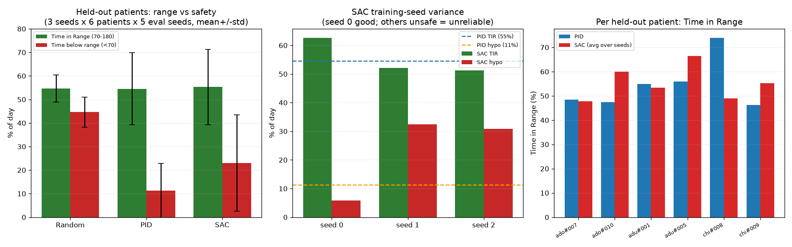

<div align="center">

# GlucoRL — Reinforcement Learning for Automated Insulin Dosing

**A deep reinforcement learning agent that learns to dose insulin to
keep blood glucose in a safe range, trained on the FDA-accepted
UVA/Padova Type-1 Diabetes simulator.**


</div>

------------------------------------------------------------------------

> This project does **not** cure diabetes —
> a cure is a biological problem. It builds an **automated
> glucose-control / insulin-dosing** controller (an "artificial
> pancreas" policy), a real and active research area where reinforcement
> learning genuinely applies. The goal is to maximize **Time in Range**
> (70–180 mg/dL) while avoiding dangerous hypoglycemia.

## Table of Contents

-   [Key Results](#key-results)
-   [Why This Problem Is Hard](#why-this-problem-is-hard)
-   [Problem Formulation (MDP)](#problem-formulation-mdp)
-   [Approach](#approach)
-   [Case Study: Diagnosing & Fixing a Failed
    Agent](#case-study-diagnosing--fixing-a-failed-agent)
-   [Project Structure](#project-structure)
-   [Installation](#installation)
-   [Reproducing the Results](#reproducing-the-results)
-   [Roadmap](#roadmap)
-   [References & Acknowledgements](#references--acknowledgements)
-   [License](#license)

## Key Results

### Headline: multi-patient generalization study

The trustworthy result. Trained on **24 patients**, evaluated on **6
held-out (never-seen) patients**, across **3 independent training seeds** ×
5 random meal scenarios each — 90 simulated evaluation days per controller.

| Controller | Time in Range ↑ | Time Below Range (hypo) ↓ | Survived |
|----|----|----|----|
| Random insulin | 54.6% | 44.6% | 0% |
| **PID baseline** | 54.5% ± 15.3 | **11.2%** | **73%** |
| **GlucoRL (pooled SAC)** | 55.3% ± 16.0 | 23.0% | 57% |



**Honest finding: GlucoRL does *not* beat the PID.** It *ties* on
Time-in-Range (55% vs 54% — well inside the ±16 variance) and is **worse on
safety**: roughly double the hypoglycemia (23% vs 11%) and more crashes
(57% vs 73% survival).

The dominant effect is **training-seed variance**:

| SAC training seed | Time in Range | Hypo (TBR) | Survived |
|----|----|----|----|
| seed 0 | 62.6% | 5.8% | 90% |
| seed 1 | 52.1% | 32.5% | 47% |
| seed 2 | 51.2% | 30.9% | 33% |

One seed produced a genuinely good, *safe* controller; two produced unsafe
ones. **Seed 0 alone would have supported a confident "SAC beats PID and is
safer" claim — and that claim would have been wrong.** Reporting all three
is the point. Making the good seed *reproducible* (variance reduction + a
stronger hypoglycemia penalty) is the next piece of work.

> **Caveat found in a later review.** In this study each seed's "best"
> checkpoint was chosen by evaluating on the *same* 6 held-out patients that
> are reported above, so the SAC numbers are optimistically biased (mild
> test-set leakage). `train_pooled.py` now selects on 3 separate validation
> patients and keeps the test set identical, so new runs are directly
> comparable — see [v2](#v2-review-fixes-and-a-redesigned-agent).

### Reference baselines (no learning, same 6 held-out patients × 5 days)

| Controller | Information used | Time in Range ↑ | TBR <70 ↓ | Survived |
|----|----|----|----|----|
| PID (repo) | CGM | 54.5% ± 15.4 | 11.2% | 70% |
| Prescribed basal only | patient's basal rate, open loop | 46.3% ± 21.3 | **0.0%** | 70% |
| Basal-bolus | basal + **announced meals** (CR/CF) | **79.7%** ± 17.1 | 5.7% | 100% |

The PID's hypoglycemia is self-inflicted: simply delivering the prescribed
basal rate never goes low. Most of it comes from three insulin-sensitive
patients (child#009 27%, adolescent#007 19%, adolescent#010 18% TBR) receiving
the *same* gains and the same absolute dose range as everyone else. The
basal-bolus row knows meal sizes the agent never sees, so it is a ceiling for
"standard of care", not a like-for-like rival. (Crashes for the basal-only
controller are BG > 600 mg/dL: uncovered meals, not lows.)

**A safety shield alone does not fix this.** Putting the predictive
low-glucose-suspend shield (`--shield`) in front of the PID barely moves its
hypoglycemia (TBR 11.2% → 11.0%, TBR < 54 still 7.4%; survival 70% → 80%),
even though it suspends insulin for ~3.7 h a day. The lows are caused by
insulin delivered *hours earlier*, which a last-moment suspend cannot recall.
Safety has to come from dosing decisions that account for insulin on board,
which is why the v2 agent observes it explicitly.

### The development story (why the single-patient number is misleading)

Trained *and* evaluated on **one** patient (`adolescent#001`), GlucoRL looks
excellent — which is precisely the trap this project documents:

| Controller | Time in Range ↑ | Time Below Range (hypo) ↓ | Survived |
|----|----|----|----|
| Random insulin | 57.6% ± 1.6 | 42.4% | 0% |
| PID baseline | 84.0% ± 3.5 | 0.0% | 100% |
| SAC — naive `[0,30]` action space *(failed)* | 53.3% ± 17.1 | 46.7% | 0% |
| GlucoRL (SAC, corrected) | **92.3% ± 4.2** | 6.2% ± 5.2 | 100% |

92% Time-in-Range on the training patient — but it **overfits**, and 6.2%
time-below-range already exceeds the clinical safety target (**\<4%**). Each
step of the progression *single patient → held-out patients → multiple
seeds* strips away more of the illusion. **Only the last row of that
progression is trustworthy**, and it is reported above.

## Why This Problem Is Hard

Blood glucose is a delayed, noisy, and **asymmetric** control problem:

-   **Delayed effect.** Injected insulin keeps lowering glucose for
    hours, so a dose now can cause a dangerous low much later — a hard
    credit-assignment problem.
-   **Asymmetric risk.** Hypoglycemia (low) can cause seizures within
    minutes; hyperglycemia (high) is mostly a long-term harm. A good
    controller must treat lows as far worse than highs.
-   **Partial observability.** A single glucose reading doesn't reveal
    whether glucose is rising or falling — the controller needs the
    *trend*.
-   **Sensor noise.** The agent sees a noisy CGM signal, not the true
    blood glucose.

## Problem Formulation (MDP)

| Element | Definition |
|----|----|
| **State** | Last 4 CGM readings + last 4 insulin doses (8-dim), exposing glucose *trend* and *insulin-on-board* |
| **Action** | Basal insulin rate, continuous, in a clinically-scaled range `[0, 0.1]` U |
| **Reward** | Negative Magni glycemic risk (asymmetric — penalizes lows much harder than highs), with a terminal penalty for crashing the patient |
| **Transition** | The simglucose UVA/Padova physiological ODE model |
| **Discount** | γ = 0.99 (≈ 5-hour effective planning horizon) |

## Approach

**Environment.** [simglucose](https://github.com/jxx123/simglucose), an
open-source implementation of the FDA-accepted UVA/Padova T1D simulator,
wrapped as a Gymnasium environment.

**State engineering** (`diabetes_rl/wrappers.py`). A
`GlucoseTrendWrapper` stacks recent glucose and insulin history so the
agent can perceive trend and insulin-on-board — the single most
important feature-engineering step.

**Reward design** (`diabetes_rl/rewards.py`). An asymmetric reward
(Magni risk and an interpretable piecewise variant) that encodes the
clinical priority: *never go low*.

**Algorithm.** [Soft Actor-Critic
(SAC)](https://arxiv.org/abs/1801.01290) — an off-policy,
continuous-control actor-critic method — via Stable-Baselines3. Insulin
dosing is continuous, which rules out value-only methods like DQN.

**From-scratch implementation** (`diabetes_rl/sac_scratch.py`). SAC is
*also* implemented from scratch in PyTorch (squashed-Gaussian policy,
twin critics, automatic entropy tuning, polyak target updates) to
demonstrate understanding of the algorithm internals rather than just
library usage. *(A head-to-head validation that it matches the
Stable-Baselines3 version is planned — see Roadmap; not yet run.)*

**Baseline.** A correction-only PID controller
(`diabetes_rl/baselines.py`) that observes the same CGM signal as the
agent, for a fair head-to-head comparison. Prescribed-basal and
meal-announced basal-bolus references were added in v2.

**More algorithms (v2).** TD3, TQC, CrossQ, PPO and RecurrentPPO via
`--algo`; see [v2](#v2-review-fixes-and-a-redesigned-agent).

## Case Study: Diagnosing & Fixing a Failed Agent

A first SAC run trained for **500,000 steps and failed completely** —
53% Time-in-Range and a crashed patient on every episode, *worse than
random*.

**Diagnosis.** Inspecting the chosen doses revealed the agent was
delivering **15–21 units** of insulin where the PID used **\~0.01** — an
overdose of \~1,000×. Root cause: the pump's action space `[0, 30]` is
enormous relative to a useful basal dose (\~0.01–0.05 U), so the safe
region was \~0.03% of the action space — effectively unfindable — and
SAC's neutral output (the midpoint, 15 U) was already a catastrophic
overdose.

**Fix.** Rescaling the action space to a clinically-sane `[0, 0.1]` U.
The agent immediately went from crashing the patient in \~1.2 hours to
surviving the full day.

This before/after is documented with figures in [`docs/`](docs/) and is,
deliberately, part of the project's story: identifying *why* a model
fails is as important as training one that works.

## v2: review fixes and a redesigned agent

A code review of the pipeline found problems that bias the numbers above, and
a root cause for the hypoglycemia / seed variance that a different algorithm
alone would not fix. Methodology fixes are on by default; everything that
would change the original setup is **opt-in** (`--env-version v2`, `--algo`,
`--shield`), so the v1 results stay reproducible.

> **Status:** implemented, unit-tested (`python -m pytest -q`) and
> smoke-trained for every algorithm. The full multi-seed v2 study has **not**
> been run yet, so no v2 performance claims are made here.

### Methodology fixes (default)

| Problem | Consequence | Fix |
|----|----|----|
| Best checkpoint chosen on the **test** patients | held-out scores biased upward | 21 train / 3 validation / 6 test split (`cohorts.train_val_test_split`); test set unchanged |
| simglucose's `reset()` **replays the same meal day** (scenario is drawn at construction) | `train_sac.py` trained on only `n_envs` distinct days; `evaluate.py`'s "5 episodes" were one day five times | `FreshEpisodeWrapper` (new day every training episode); a freshly seeded env per evaluation episode |
| Validation drew new random days at every evaluation | noisy "best checkpoint" | `FixedEpisodesWrapper`: the same fixed validation days every time |
| `setuptools>=81` removed `pkg_resources`, which simglucose imports | a fresh `pip install` cannot import simglucose | `setuptools<81` pinned; lock file re-encoded UTF-16 → UTF-8 |

### Why the agent overdoses: one action range for a 6× range of patients

Prescribed basal rates differ **6×** across the 30 virtual patients
(child#003 ≈ 0.005 U/min, adult#006 ≈ 0.029 U/min). The v1 agent acts in
absolute `[0, 0.1]` U/min for everyone, and SAC's *untrained, neutral* output
(0.05 U/min) is already **~10× a child's basal rate**. With only 12 minutes of
CGM history the policy cannot tell which patient it is dosing. That matches
the observed failure (over-dosing into hypoglycemia, very seed-dependent)
better than "SAC is unstable" does. Separately, the v1 terminal penalty (100)
is worth about **one step** of severe hypoglycemia (Magni risk ≈ 84 at
40 mg/dL, ≈ 400 at 10 mg/dL), so crashing is barely discouraged.

### v2 environment (`--env-version v2`, `GlucoseControlWrapper`)

| Change | Rationale |
|----|----|
| **Basal-relative action** in `[-1, 1]`: −1 = suspend, 0 = prescribed basal, +1 = 5× basal | one policy means the same thing for every patient; the network's neutral output is the safe clinical default. Pumps always know the prescribed basal |
| **Insulin-on-board** (2-compartment model, τ = 55 min) relative to basal | insulin acts for ~5 h; the last four doses (12 min) cannot represent that |
| **1 h CGM history** + least-squares trend | longer context for meals and trends |
| **Time of day** (sin/cos) | simglucose meals cluster at breakfast / lunch / dinner |
| **Normalized reward** in [−1, 1] + terminal penalty 1/(1−γ) | a crash is now strictly worse than any survivable day |
| Optional **safety shield** (`--shield`, `diabetes_rl/safety.py`) | predictive low-glucose suspend, as in commercial pumps: no insulin if CGM < 70 or the 30-min projection < 80 mg/dL |

### More algorithms (`--algo`, `diabetes_rl/algos.py`)

`sac` (original), `td3`, **`tqc`** (truncated quantile critics: curbs the
Q-overestimation that shows up here as over-dosing), **`crossq`** (much more
sample-efficient: the simulator, at ~100–200 steps/s/core, is the bottleneck),
`ppo`, and **`recurrentppo`** (LSTM memory for unobserved meals / insulin).

### Evaluation upgrades (`scripts/benchmark.py`)

* Extra baselines: prescribed basal, and meal-announced basal-bolus (`--with-bb`).
* **Ensembles**: `--model A B C` also scores the median action of several
  seeds. Training-seed variance is the dominant effect, and a median of three
  policies needs two of them to agree before it overdoses.
* `--shield` puts the same safety shield in front of *every* controller, including v1 models.
* Clinical metrics in the CSV: TBR < 54, TAR > 250, CV, LBGI/HBGI and the
  Glycemia Risk Index, alongside the consensus targets (TIR > 70%, TBR < 4%).
* Each controller runs in its own freshly seeded env (identical day); the
  agent's env is rebuilt from the `config.json` saved at training time.

### Running the v2 study

``` bash
python -m pytest -q
python scripts/run_study.py --env-version v2 --algo tqc --tag v2-tqc --ensemble --shield-eval --with-bb
python scripts/run_study.py --env-version v2 --algo crossq --tag v2-crossq --ensemble
python scripts/plot_study.py --tag v2-tqc --out docs/study_v2_tqc.png
```

## Project Structure

```         
diabetes_rl/                  reusable package
├── envs.py                   simglucose Gymnasium env registration + factory
├── wrappers.py               v1 + v2 agent wrappers, episode control, env factory
├── cohorts.py                patient cohorts + train/validation/test splits
├── patients.py               per-patient basal rate, CR, CF (pump settings)
├── rewards.py                asymmetric reward functions (Magni, zone)
├── baselines.py              PID, prescribed-basal and basal-bolus controllers
├── safety.py                 predictive low-glucose-suspend safety shield
├── algos.py                  SAC / TD3 / TQC / CrossQ / PPO / RecurrentPPO factory
├── config.py                 run config.json -> identical eval env
├── metrics.py                glycemic metrics (TIR, TBR, CV, LBGI/HBGI, GRI)
└── sac_scratch.py            SAC implemented from scratch in PyTorch
scripts/
├── check_env.py              environment sanity check (random policy)
├── pid_baseline.py           run + plot the PID baseline
├── train_sac.py              train SAC (single patient; parallel envs, checkpoints)
├── train_pooled.py           pooled multi-patient training, validation-based selection
├── train_scratch.py          train the from-scratch SAC
├── evaluate.py               agent vs PID, head-to-head plot
├── benchmark.py              baselines vs agent(s)/ensemble (+ shield, significance test)
├── run_study.py              train + benchmark several seeds end to end
├── plot_study.py             multi-seed study figure
└── plot_training.py          learning curve from the eval logs
tests/                        fast unit tests (python -m pytest -q)
docs/                         figures and the methods deep-dive
requirements.txt              dependencies
requirements-lock.txt         exact pinned versions (reproducibility)
```

## Installation

Requires [Anaconda/Miniconda](https://docs.conda.io/). Tested on Windows
with Python 3.11.

``` bash
conda create -n diabetes-rl python=3.11 -y
conda activate diabetes-rl
pip install -r requirements.txt
```

For exact reproducibility, use the pinned versions:
`pip install -r requirements-lock.txt`.

## Reproducing the Results

``` bash
# 1. Sanity-check the environment (random policy)

python scripts/check_env.py

# 2. Run the PID baseline

python scripts/pid_baseline.py

# 3. Train the agent (parallel envs; checkpoints + best-model saving)

python scripts/train_sac.py --timesteps 200000 --n-envs 6

# 4. Plot the learning curve

python scripts/plot_training.py

# 5. Benchmark agent vs PID vs random (multi-patient, multi-seed)

python scripts/benchmark.py --model models/best/best_model --seeds 5

# 6. Generalization study: pooled training (21 train / 3 validation / 6 held-out),

#    then benchmark on the HELD-OUT set (train_pooled.py prints the exact command)

python scripts/train_pooled.py --timesteps 500000 --n-envs 6 --seed 0

# 7. Whole study in one command (several seeds + aggregate); v2 options above

python scripts/run_study.py --seeds 0 1 2

# Optional: watch training live

tensorboard --logdir logs
```

## Roadmap

-   [x] Gymnasium environment, state/reward engineering, PID baseline
-   [x] SAC training pipeline (parallel envs, checkpointing, best-model
    eval)
-   [x] From-scratch SAC implementation in PyTorch
-   [x] Rigorous multi-patient × multi-seed benchmark harness
-   [x] Diagnosed & fixed the action-space failure mode
-   [x] Agent beats PID on its *training* patient (92% vs 84% TIR) — but
    overfits to unseen patients (documented above)
-   [x] Cross-patient generalization study: pooled training on 24
    patients, held-out evaluation on 6 unseen patients × 3 training seeds
    — result: ties PID on Time-in-Range, worse on hypoglycemia, high
    seed variance (documented above)
-   [x] Review fixes: leakage-free model selection, fresh meal day per
    episode, fixed validation days, install pin (see [v2](#v2-review-fixes-and-a-redesigned-agent))
-   [x] v2 env (basal-relative action, IOB, time of day, normalized reward),
    safety shield, TQC / CrossQ / TD3 / PPO / RecurrentPPO, seed ensembles,
    basal and basal-bolus baselines, clinical metrics, unit tests
-   [ ] **Run the v2 multi-seed study** (TQC and CrossQ first; ≥ 5 seeds) and
    report it next to the v1 table
-   [ ] **Reduce training-seed variance** and cut hypoglycemia so the seed-0
    quality is reproducible (v2 + ensemble + shield are the candidate fixes)
-   [ ] Ablations: v1 vs v2 state; absolute vs basal-relative action; reward
    (Magni vs zone); shield during training vs evaluation only
-   [ ] Constrained RL (maximize TIR subject to TBR < 4%, e.g. Lagrangian SAC/PPO)
-   [ ] Meal-announced (hybrid closed-loop) agent, compared against basal-bolus
-   [ ] Tuned, patient-scaled PID with anti-windup (`integral_limit`) as a stronger classical baseline
-   [ ] Validate from-scratch SAC matches Stable-Baselines3

## References & Acknowledgements

-   Xie, J. *simglucose: a Type-1 Diabetes simulator* —
    <https://github.com/jxx123/simglucose>
-   Man et al. (2014). *The UVA/PADOVA Type 1 Diabetes Simulator: New
    Features.* J. Diabetes Sci. Technol.
-   Haarnoja et al. (2018). *Soft Actor-Critic.*
    <https://arxiv.org/abs/1801.01290>
-   Magni et al. (2007). *Evaluating the efficacy of closed-loop glucose
    regulation.* (glycemic risk index)
-   Raffin et al. (2021). *Stable-Baselines3.* JMLR.

A detailed code/architecture deep-dive is in
[`Glucose_RL_Pipeline_Deep_Dive.docx`](Glucose_RL_Pipeline_Deep_Dive.docx).

## Author

**Zubair Malik** — Master of Data Science, Monash University, Melbourne.

## License

MIT — see [LICENSE](LICENSE).

------------------------------------------------------------------------

<div align="center">

<sub>Built as a portfolio project exploring reinforcement learning for
healthcare control problems.</sub>

</div>