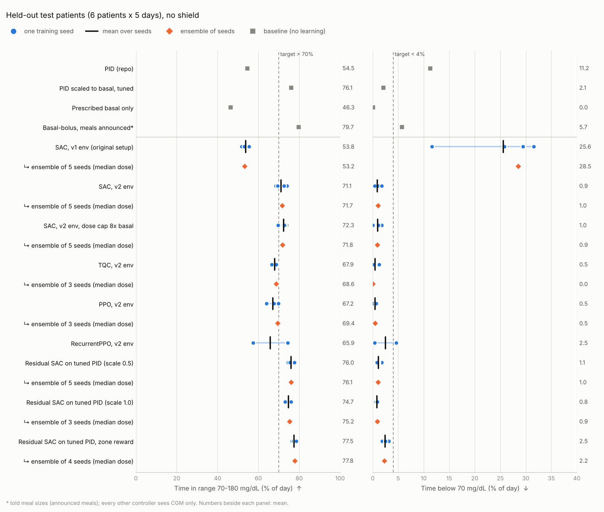
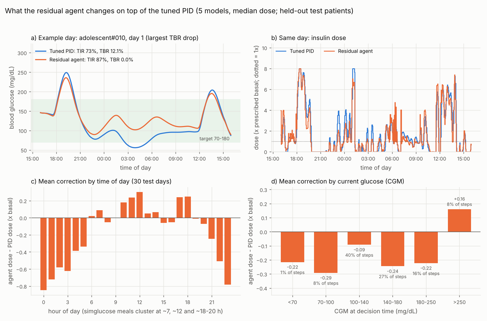

<div align="center">

# GlucoRL — Reinforcement Learning for Automated Insulin Dosing

**A deep reinforcement learning agent that learns to dose insulin to
keep blood glucose in a safe range, trained on the FDA-accepted
UVA/Padova Type-1 Diabetes simulator.**


</div>

------------------------------------------------------------------------

> This project does **not** cure diabetes —
> a cure is a biological problem. It builds an **automated
> glucose-control / insulin-dosing** controller (an "artificial
> pancreas" policy), a real and active research area where reinforcement
> learning genuinely applies. The goal is to maximize **Time in Range**
> (70–180 mg/dL) while avoiding dangerous hypoglycemia.

## Table of Contents

-   [Key Results](#key-results)
-   [Why This Problem Is Hard](#why-this-problem-is-hard)
-   [Problem Formulation (MDP)](#problem-formulation-mdp)
-   [Approach](#approach)
-   [Case Study: Diagnosing & Fixing a Failed
    Agent](#case-study-diagnosing--fixing-a-failed-agent)
-   [Project Structure](#project-structure)
-   [Installation](#installation)
-   [Reproducing the Results](#reproducing-the-results)
-   [Roadmap](#roadmap)
-   [References & Acknowledgements](#references--acknowledgements)
-   [License](#license)

## Key Results

> **Latest: residual RL reaches the classical bar.** An RL agent that learns
> bounded corrections on top of the tuned, patient-scaled PID (residual SAC)
> matches that PID on the 6 held-out patients: **76.0% vs 76.1% time in range,
> with 1.1% vs 2.1% time below range** (5 training seeds, all meeting the
> < 4% target). Plain SAC on the same environment stays 4.9 TIR points lower
> at the same hypoglycemia. Trained with a TIR-oriented reward, the residual
> agent beats the PID's time in range (+1.4 points, p = 0.001), but at the
> cost of more hypoglycemia in children. See [v2](#v2-review-fixes-and-a-redesigned-agent)
> and [Residual RL](#residual-rl-on-top-of-the-tuned-pid). The sections below
> keep the original study as it was reported.

### Headline: multi-patient generalization study

The trustworthy result. Trained on **24 patients**, evaluated on **6
held-out (never-seen) patients**, across **3 independent training seeds** ×
5 random meal scenarios each — 90 simulated evaluation days per controller.

| Controller | Time in Range ↑ | Time Below Range (hypo) ↓ | Survived |
|----|----|----|----|
| Random insulin | 54.6% | 44.6% | 0% |
| **PID baseline** | 54.5% ± 15.3 | **11.2%** | **73%** |
| **GlucoRL (pooled SAC)** | 55.3% ± 16.0 | 23.0% | 57% |


**Honest finding: GlucoRL does *not* beat the PID.** It *ties* on
Time-in-Range (55% vs 54% — well inside the ±16 variance) and is **worse on
safety**: roughly double the hypoglycemia (23% vs 11%) and more crashes
(57% vs 73% survival).

The dominant effect is **training-seed variance**:

| SAC training seed | Time in Range | Hypo (TBR) | Survived |
|----|----|----|----|
| seed 0 | 62.6% | 5.8% | 90% |
| seed 1 | 52.1% | 32.5% | 47% |
| seed 2 | 51.2% | 30.9% | 33% |

One seed produced a genuinely good, *safe* controller; two produced unsafe
ones. **Seed 0 alone would have supported a confident "SAC beats PID and is
safer" claim — and that claim would have been wrong.** Reporting all three
is the point. Making the good seed *reproducible* (variance reduction + a
stronger hypoglycemia penalty) is the next piece of work.

> **Caveat found in a later review.** In this study each seed's "best"
> checkpoint was chosen by evaluating on the *same* 6 held-out patients that
> are reported above, so the SAC numbers are optimistically biased (mild
> test-set leakage). `train_pooled.py` now selects on 3 separate validation
> patients and keeps the test set identical, so new runs are directly
> comparable — see [v2](#v2-review-fixes-and-a-redesigned-agent).

### Reference baselines (no learning, same 6 held-out patients × 5 days)

| Controller | Information used | Time in Range ↑ | TBR <70 ↓ | TBR <54 ↓ | Survived |
|----|----|----|----|----|----|
| PID (repo) | CGM | 54.5% ± 15.2 | 11.2% | 8.0% | 73% |
| **PID scaled to basal, tuned** | CGM + prescribed basal | **76.1%** ± 11.8 | **2.1%** | **0.3%** | 90% |
| Prescribed basal only | prescribed basal, open loop | 46.3% ± 20.9 | 0.0% | 0.0% | 70% |
| Basal-bolus | basal + **announced meals** (CR/CF) | 79.7% ± 16.8 | 5.7% | 1.7% | 97% |

The PID's hypoglycemia is self-inflicted: simply delivering the prescribed
basal rate never goes low. Most of it comes from three insulin-sensitive
patients (child#009 27%, adolescent#007 19%, adolescent#010 18% TBR) receiving
the *same* gains and the same absolute dose range as everyone else. The
basal-bolus row knows meal sizes the agent never sees, so it is a ceiling for
"standard of care", not a like-for-like rival.

**A classical controller that scales its doses to each patient's prescribed
basal rate** (`BasalPIDController`, gains tuned on the 21 *training* patients
only, `scripts/tune_pid.py`) gets within 4 points of that ceiling without
knowing about meals, with less hypoglycemia, and meets the consensus targets
for TIR (> 70%), TBR (< 4%) and TBR < 54 (< 1%). **This, not the original
PID, is the bar an RL agent has to clear.** (Its 3 crashes, like all of the
basal-only controller's, are BG > 600 mg/dL: uncovered meals, not lows.)

**A safety shield alone does not fix this.** Putting the predictive
low-glucose-suspend shield (`--shield`) in front of the PID barely moves its
hypoglycemia (TBR 11.2% → 11.0%, TBR < 54 8.0% → 7.4%; survival 73% → 80%),
even though it suspends insulin for ~3.7 h a day. The lows are caused by
insulin delivered *hours earlier*, which a last-moment suspend cannot recall.
Safety has to come from dosing decisions that account for insulin on board,
which is why the v2 agent observes it explicitly.

### The development story (why the single-patient number is misleading)

Trained *and* evaluated on **one** patient (`adolescent#001`), GlucoRL looks
excellent — which is precisely the trap this project documents:

| Controller | Time in Range ↑ | Time Below Range (hypo) ↓ | Survived |
|----|----|----|----|
| Random insulin | 57.6% ± 1.6 | 42.4% | 0% |
| PID baseline | 84.0% ± 3.5 | 0.0% | 100% |
| SAC — naive `[0,30]` action space *(failed)* | 53.3% ± 17.1 | 46.7% | 0% |
| GlucoRL (SAC, corrected) | **92.3% ± 4.2** | 6.2% ± 5.2 | 100% |

92% Time-in-Range on the training patient — but it **overfits**, and 6.2%
time-below-range already exceeds the clinical safety target (**\<4%**). Each
step of the progression *single patient → held-out patients → multiple
seeds* strips away more of the illusion. **Only the last row of that
progression is trustworthy**, and it is reported above.

## Why This Problem Is Hard

Blood glucose is a delayed, noisy, and **asymmetric** control problem:

-   **Delayed effect.** Injected insulin keeps lowering glucose for
    hours, so a dose now can cause a dangerous low much later — a hard
    credit-assignment problem.
-   **Asymmetric risk.** Hypoglycemia (low) can cause seizures within
    minutes; hyperglycemia (high) is mostly a long-term harm. A good
    controller must treat lows as far worse than highs.
-   **Partial observability.** A single glucose reading doesn't reveal
    whether glucose is rising or falling — the controller needs the
    *trend*.
-   **Sensor noise.** The agent sees a noisy CGM signal, not the true
    blood glucose.

## Problem Formulation (MDP)

| Element | Definition |
|----|----|
| **State** | Last 4 CGM readings + last 4 insulin doses (8-dim), exposing glucose *trend* and *insulin-on-board* |
| **Action** | Basal insulin rate, continuous, in a clinically-scaled range `[0, 0.1]` U |
| **Reward** | Negative Magni glycemic risk (asymmetric — penalizes lows much harder than highs), with a terminal penalty for crashing the patient |
| **Transition** | The simglucose UVA/Padova physiological ODE model |
| **Discount** | γ = 0.99 (≈ 5-hour effective planning horizon) |

## Approach

**Environment.** [simglucose](https://github.com/jxx123/simglucose), an
open-source implementation of the FDA-accepted UVA/Padova T1D simulator,
wrapped as a Gymnasium environment.

**State engineering** (`diabetes_rl/wrappers.py`). A
`GlucoseTrendWrapper` stacks recent glucose and insulin history so the
agent can perceive trend and insulin-on-board — the single most
important feature-engineering step.

**Reward design** (`diabetes_rl/rewards.py`). An asymmetric reward
(Magni risk and an interpretable piecewise variant) that encodes the
clinical priority: *never go low*.

**Algorithm.** [Soft Actor-Critic
(SAC)](https://arxiv.org/abs/1801.01290) — an off-policy,
continuous-control actor-critic method — via Stable-Baselines3. Insulin
dosing is continuous, which rules out value-only methods like DQN.

**From-scratch implementation** (`diabetes_rl/sac_scratch.py`). SAC is
*also* implemented from scratch in PyTorch (squashed-Gaussian policy,
twin critics, automatic entropy tuning, polyak target updates) to
demonstrate understanding of the algorithm internals rather than just
library usage. *(A head-to-head validation that it matches the
Stable-Baselines3 version is planned — see Roadmap; not yet run.)*

**Baseline.** A correction-only PID controller
(`diabetes_rl/baselines.py`) that observes the same CGM signal as the
agent, for a fair head-to-head comparison. Prescribed-basal and
meal-announced basal-bolus references were added in v2.

**More algorithms (v2).** TD3, TQC, CrossQ, PPO and RecurrentPPO via
`--algo`; see [v2](#v2-review-fixes-and-a-redesigned-agent).

## Case Study: Diagnosing & Fixing a Failed Agent

A first SAC run trained for **500,000 steps and failed completely** —
53% Time-in-Range and a crashed patient on every episode, *worse than
random*.

**Diagnosis.** Inspecting the chosen doses revealed the agent was
delivering **15–21 units** of insulin where the PID used **\~0.01** — an
overdose of \~1,000×. Root cause: the pump's action space `[0, 30]` is
enormous relative to a useful basal dose (\~0.01–0.05 U), so the safe
region was \~0.03% of the action space — effectively unfindable — and
SAC's neutral output (the midpoint, 15 U) was already a catastrophic
overdose.

**Fix.** Rescaling the action space to a clinically-sane `[0, 0.1]` U.
The agent immediately went from crashing the patient in \~1.2 hours to
surviving the full day.

This before/after is documented with figures in [`docs/`](docs/) and is,
deliberately, part of the project's story: identifying *why* a model
fails is as important as training one that works.

## v2: review fixes and a redesigned agent

A code review of the pipeline found problems that bias the numbers above, and
a root cause for the hypoglycemia / seed variance that a different algorithm
alone would not fix. Methodology fixes are on by default; everything that
would change the original setup is **opt-in** (`--env-version v2`, `--algo`,
`--shield`), so the v1 results stay reproducible.

> **Status:** 35 training runs completed: the 21 runs of the first v2 study,
> seed 4 of v2-SAC and of the 8x-cap variant, and 12 residual-RL runs
> (RecurrentPPO seed 2 and CrossQ were not run). All models were trained and
> scored with the code in this repository.

### Results: held-out test patients (6 patients × 5 days)

Every model is the checkpoint chosen on the 3 **validation** patients, scored
on the 6 untouched test patients over the same 30 simulated days as the
baselines. 500k training steps per seed. "Ensemble" = median dose of all
seeds of a configuration.



| Controller | Seeds | Time in Range ↑ | TBR <70 ↓ | TBR <54 ↓ | GRI ↓ | Survived | vs tuned basal PID (TIR, paired) |
|----|----|----|----|----|----|----|----|
| PID (repo) | – | 54.5% | 11.2% | 8.0% | 68 | 73% | –21.6 |
| **PID scaled to basal, tuned** | – | **76.1%** | 2.1% | 0.3% | 30 | 90% | – |
| Basal-bolus, meals announced (reference) | – | 79.7% | 5.7% | 1.7% | 32 | 97% | +3.6 |
| SAC, v1 env (original setup) | 5 | 53.8% ± 1.3 | 25.6% ± 7.2 | 19.4% | 79 | 38% | –22.3 (p < 0.001) |
| SAC, v2 env | 5 | 71.1% ± 2.0 | 0.9% ± 0.6 | 0.0% | 32 | 87% | –4.9 (p = 0.002) |
| ↳ ensemble of the 5 seeds | – | 71.7% | 1.0% | 0.0% | 32 | 90% | –4.4 (p = 0.004) |
| SAC, v2 env, dose cap 8× basal | 5 | 72.3% ± 1.4 | 1.0% ± 0.6 | 0.2% | 31 | 89% | –3.7 (p = 0.007) |
| TQC, v2 env | 3 | 67.9% ± 1.0 | 0.5% ± 0.6 | 0.0% | 35 | 84% | –8.2 (p < 0.001) |
| PPO, v2 env | 3 | 67.2% ± 2.4 | 0.5% ± 0.3 | 0.0% | 36 | 83% | –8.9 (p < 0.001) |
| RecurrentPPO, v2 env | 2 | 65.9% ± 8.5 | 2.5% ± 2.1 | 0.6% | 42 | 87% | –10.2 (p < 0.001) |
| **Residual SAC on the tuned PID** (`--residual 0.5`) | 5 | **76.0% ± 1.2** | **1.1% ± 0.3** | 0.4% | **28** | 91% | –0.1 (p = 0.48) |
| ↳ ensemble of the 5 seeds | – | 76.1% | 1.0% | 0.3% | 28 | 90% | +0.0 (p = 0.35) |
| Residual SAC, scale 1.0 (ablation) | 3 | 74.7% ± 1.2 | 0.8% ± 0.1 | 0.3% | 29 | 90% | –1.4 (p = 0.041) |
| Residual SAC, zone reward (ablation) | 4 | 77.5% ± 0.8 | 2.5% ± 0.5 | 0.8% | 29 | 92% | **+1.4 (p = 0.001)** |
| ↳ ensemble of the 4 seeds | – | 77.8% | 2.2% | 0.9% | 28 | 93% | +1.7 |

GRI = Glycemia Risk Index (0–100, a composite of time low and time high;
lower is better).

1. **The environment redesign fixes the overdosing.** Same algorithm (SAC),
   hyperparameters and budget: hypoglycemia drops from **25.6% to 0.9%** of
   the day and time in range rises **53.8% → 71.1%**. All 5 v2 seeds meet
   the < 4% hypoglycemia target; none of the 5 v1 seeds does. Against the
   original PID, v2-SAC gains +16.6 TIR points with 10.3 points less
   hypoglycemia (paired Wilcoxon over the 30 days, both p < 0.001).
2. **With leakage-free checkpoint selection, no v1 seed reproduces the
   original "good" seed 0** (62.6% TIR / 5.8% TBR); all five overdose (TBR
   11.6–31.6%). That seed's checkpoint had been picked on the test patients,
   so part of its apparent safety was likely a selection effect (the training
   set, 21 vs 24 patients, and random streams also differ).
3. **The algorithm matters far less than the environment.** SAC, TQC and PPO
   on v2 all land at 67–72% TIR with ≤ 1% hypoglycemia; TQC and PPO are more
   conservative (more time high). RecurrentPPO's two seeds disagree by 17 TIR
   points (57% vs 74%), the least reliable at this training budget.
4. **RL learned from scratch does not beat a well-tuned classical
   controller here.** The best plain agents are 4–5 TIR points below the
   basal-scaled PID tuned on training patients, at similar or lower
   hypoglycemia. Raising the dose cap from 5× to 8× basal (the PID's cap)
   adds only +1.2 points: the cap was not the main gap.
5. **Seed ensembles help a little; a safety shield helps only unsafe
   controllers.** Median-dose ensembles match or slightly beat the average
   seed. The shield cuts v1-SAC's severe hypoglycemia from 22.0% to 11.7% and
   doubles its survival (33% → 68%), but leaves 21% TBR; on v2 agents it
   changes almost nothing.
6. **Residual RL closes the gap.** Letting SAC learn bounded corrections on
   top of the tuned PID (instead of the whole controller) is the first RL
   configuration that reaches the classical bar: 76.0% TIR vs 76.1%, with
   1.1% vs 2.1% hypoglycemia and the lowest GRI of any CGM-only controller
   (28 vs 30; the TBR and GRI gaps are within noise over 30 days). Against
   plain SAC on the same environment it gains **+4.9 TIR points at the same
   hypoglycemia** (p < 0.001, better on 28 of 30 days; GRI −4.4,
   p < 0.001), and its 5 seeds agree closely (± 1.2 TIR). See
   [Residual RL](#residual-rl-on-top-of-the-tuned-pid).
7. **The reward sets the trade-off, and the averages hide who pays for
   it.** The Magni risk used everywhere costs as much at 70 mg/dL as at
   ~280 mg/dL, so agents trade time in range for fewer lows. With the
   repository's TIR-oriented `zone` reward the residual agent **beats the
   tuned PID on time in range**: +1.4 points (p = 0.001, higher on 23 of 30
   days), 77.5% vs 76.1%, at similar overall hypoglycemia (2.5% vs 2.1%,
   n.s.). But by cohort the gain is all in adults (85% vs 80% TIR), while
   children get *more* hypoglycemia (6.8% vs 5.0% TBR) and severe lows rise
   to 0.8% (vs 0.3%; still under the 1% target). The Magni-reward residual
   agent is the safer controller: it brings the children under the 4%
   hypoglycemia target (3.4% vs the PID's 5.0%) while matching the PID's
   overall TIR (plain v2-SAC also keeps children under 4%, but at 5 TIR
   points less).

**What would most likely help next:** meal announcement (the basal-bolus
reference shows the value of meal information; residual RL on top of a
meal-aware controller is the natural next step), and constrained RL with an
explicit TBR < 4% constraint per patient group instead of reward shaping:
finding 7 shows a single averaged objective lets an agent trade one group's
safety for another group's time in range.

Full tables, including per-cohort results and the evaluation with every
controller behind the safety shield, are in
[`docs/study_comparison.md`](docs/study_comparison.md). The raw per-day
results of every run are in [`docs/study_results/`](docs/study_results/);
`python scripts/compare_studies.py --study-dir docs/study_results`
regenerates the tables and figures from them.

### Residual RL on top of the tuned PID

Plain agents learn the whole controller from scratch and landed 4–5 TIR
points below the tuned PID. Residual RL **keeps the PID and learns a bounded
correction to it** (`--residual SCALE`, `ResidualPIDWrapper`):

```
final action = clip(a_PID + scale × a_agent, −1, 1)      (v2 basal-relative action space)
```

* `a_PID` is the tuned `BasalPIDController`'s dose written in the v2 action
  space. An agent action of 0 reproduces the PID exactly (a unit test checks
  the blood-glucose trace is identical), and `train_pooled.py`
  **zero-initializes the policy's output layer**, so the *untrained* agent is
  the tuned PID: learning starts from the strongest classical controller
  instead of from random dosing, and every validation checkpoint is a
  refinement of it.
* `scale` bounds the agent's authority (0.5: from basal it can go from 0.5×
  to 4.5×). This also keeps exploration close to a safe controller. Scale
  1.0 was slightly more conservative and 1.3 TIR points worse (p = 0.002).
* The observation is the v2 observation plus the PID's proposal and its
  integral term, so the agent sees what it is correcting. Information used:
  CGM and the prescribed basal rate only, exactly like the PID and the plain
  v2 agent.

Same budget as every other run (500k steps, 6 workers, checkpoint chosen on
the validation patients). Validation scores were also far steadier than plain
SAC's (best checkpoints at 100–225k steps, little drift afterwards).



**What it learned** (5-seed median ensemble on the 30 held-out test days,
`scripts/analyze_residual.py`): it gives about the same total insulin as the
PID (0.97×) but redistributes it.

* **Less insulin overnight** (21:00–05:00, down to −0.8× basal): 76% of the
  PID's time below 70 mg/dL falls between 21:00 and 06:00, where its late
  corrections stack with dinner insulin. In the example day the PID drives
  adolescent#010 to 56 mg/dL at about 04:00; the agent's version of that day
  has no low (TIR 73% → 87%, TBR 12.1% → 0%).
* **More insulin before and around lunch and dinner** (10–12 h and 17–18 h):
  anticipation it can only learn from the time-of-day features, because
  meals are never announced.
* **Less insulin at almost every glucose level, more above 250 mg/dL.**

It is not a uniform improvement: the agent has higher TIR than the PID on 13
of the 30 days and lower on others (worst: adult#001, about −10 TIR points on
two days, spending more time high; one child#008 day has more hypoglycemia,
9.0% vs 6.2%). Its gains come mostly from the three insulin-sensitive,
hypo-prone patients (child#009, child#008, adolescent#010).

``` bash
python scripts/train_pooled.py --env-version v2 --residual 0.5 --tag v2-res-sac --seed 0
python scripts/run_study.py --env-version v2 --residual 0.5 --tag v2-res-sac --seeds 0 1 2 3 4 --ensemble
python scripts/analyze_residual.py --model models/pooled/v2-res-sac/best_seed{0,1,2,3,4}/best_model \
    --example max-tbr-drop --out docs/residual_analysis.png
```

### Methodology fixes (default)

| Problem | Consequence | Fix |
|----|----|----|
| Best checkpoint chosen on the **test** patients | held-out scores biased upward | 21 train / 3 validation / 6 test split (`cohorts.train_val_test_split`); test set unchanged |
| simglucose's `reset()` **replays the same meal day** (scenario is drawn at construction) | `train_sac.py` trained on only `n_envs` distinct days; `evaluate.py`'s "5 episodes" were one day five times | `FreshEpisodeWrapper` (new day every training episode); a freshly seeded env per evaluation episode |
| Validation drew new random days at every evaluation | noisy "best checkpoint" | `FixedEpisodesWrapper`: the same fixed validation days every time |
| `setuptools>=81` removed `pkg_resources`, which simglucose imports | a fresh `pip install` cannot import simglucose | `setuptools<81` pinned; lock file re-encoded UTF-16 → UTF-8 |

### Why the agent overdoses: one action range for a 6× range of patients

Prescribed basal rates differ **6×** across the 30 virtual patients
(child#003 ≈ 0.005 U/min, adult#006 ≈ 0.029 U/min). The v1 agent acts in
absolute `[0, 0.1]` U/min for everyone, and SAC's *untrained, neutral* output
(0.05 U/min) is already **~10× a child's basal rate**. With only 12 minutes of
CGM history the policy cannot tell which patient it is dosing. That matches
the observed failure (over-dosing into hypoglycemia, very seed-dependent)
better than "SAC is unstable" does. Separately, the v1 terminal penalty (100)
is worth about **one step** of severe hypoglycemia (Magni risk ≈ 84 at
40 mg/dL, ≈ 400 at 10 mg/dL), so crashing is barely discouraged.

### v2 environment (`--env-version v2`, `GlucoseControlWrapper`)

| Change | Rationale |
|----|----|
| **Basal-relative action** in `[-1, 1]`: −1 = suspend, 0 = prescribed basal, +1 = 5× basal | one policy means the same thing for every patient; the network's neutral output is the safe clinical default. Pumps always know the prescribed basal |
| **Insulin-on-board** (2-compartment model, τ = 55 min) relative to basal | insulin acts for ~5 h; the last four doses (12 min) cannot represent that |
| **1 h CGM history** + least-squares trend | longer context for meals and trends |
| **Time of day** (sin/cos) | simglucose meals cluster at breakfast / lunch / dinner |
| **Normalized reward** in [−1, 1] + terminal penalty 1/(1−γ) | a crash is now strictly worse than any survivable day |
| Optional **safety shield** (`--shield`, `diabetes_rl/safety.py`) | predictive low-glucose suspend, as in commercial pumps: no insulin if CGM < 70 or the 30-min projection < 80 mg/dL |

### More algorithms (`--algo`, `diabetes_rl/algos.py`)

`sac` (original), `td3`, **`tqc`** (truncated quantile critics: curbs the
Q-overestimation that shows up here as over-dosing), **`crossq`** (more
sample-efficient per environment step, but its wide critics make each update
~4× costlier than SAC's on a CPU), `ppo`, and **`recurrentppo`** (LSTM memory
for unobserved meals / insulin).

### ~11× faster simulator (`diabetes_rl/fastsim.py`)

Profiling showed ~90% of simglucose's time was not physics: its ODE reads ~40
patient parameters as attributes of a pandas Series on every derivative
evaluation. `fastsim` hands the solver plain floats while it integrates
(31 → ~350 simulator steps/s per core). Parameter values are bit-identical;
the insulin dose is carried as a float64 instead of a 1-element float32
array, which moved blood glucose by at most 0.0002 mg/dL over 12 simulated
days with identical TIR/TBR. It is on by default (`DIABETES_RL_FASTSIM=0`
turns it off) and a unit test compares it against simglucose's own step. A
500k-step study run now takes about 1–2 CPU-hours instead of 10+.

### A stronger classical baseline (`BasalPIDController`, `scripts/tune_pid.py`)

A PID that doses *around the patient's prescribed basal rate*, with
per-patient scaling, anti-windup and a least-squares trend: the same
information the v2 agent has. Its gains are tuned by random search on the
**training** patients only (Glycemia Risk Index objective), never on test
patients.

### Evaluation upgrades (`scripts/benchmark.py`)

* Extra baselines: prescribed basal, and meal-announced basal-bolus (`--with-bb`).
* **Ensembles**: `--model A B C` also scores the median action of several
  seeds. Training-seed variance is the dominant effect, and a median of three
  policies needs two of them to agree before it overdoses.
* `--shield` puts the same safety shield in front of *every* controller, including v1 models.
* Clinical metrics in the CSV: TBR < 54, TAR > 250, CV, LBGI/HBGI and the
  Glycemia Risk Index, alongside the consensus targets (TIR > 70%, TBR < 4%).
* Each controller runs in its own freshly seeded env (identical day); the
  agent's env is rebuilt from the `config.json` saved at training time.

### Running the v2 study

``` bash
python -m pytest -q
python scripts/run_study.py --env-version v2 --algo tqc --tag v2-tqc --ensemble --shield-eval --with-bb
python scripts/run_study.py --env-version v2 --algo crossq --tag v2-crossq --ensemble
python scripts/tune_pid.py --candidates 60          # tuned classical baseline
python scripts/compare_studies.py                   # every configuration side by side
```

Long runs are **resumable**: `train_pooled.py` snapshots the model, replay
buffer and validation history every 25k steps (`--resume-freq`), and simply
rerunning the same command continues from the last snapshot. When several
runs share one machine, `--vec-env dummy` keeps each run's environments
in-process (one PyTorch process per run instead of one per environment).

## Project Structure

```         
diabetes_rl/                  reusable package
├── envs.py                   simglucose Gymnasium env registration + factory
├── wrappers.py               v1 + v2 + residual-PID agent wrappers, episode control, env factory
├── cohorts.py                patient cohorts + train/validation/test splits
├── patients.py               per-patient basal rate, CR, CF (pump settings)
├── rewards.py                asymmetric reward functions (Magni, zone)
├── baselines.py              PID, basal-scaled PID, prescribed-basal, basal-bolus
├── safety.py                 predictive low-glucose-suspend safety shield
├── fastsim.py                ~11x faster simglucose, same results
├── algos.py                  SAC / TD3 / TQC / CrossQ / PPO / RecurrentPPO factory
├── config.py                 run config.json -> identical eval env
├── metrics.py                glycemic metrics (TIR, TBR, CV, LBGI/HBGI, GRI)
└── sac_scratch.py            SAC implemented from scratch in PyTorch
scripts/
├── check_env.py              environment sanity check (random policy)
├── pid_baseline.py           run + plot the PID baseline
├── train_sac.py              train SAC (single patient; parallel envs, checkpoints)
├── train_pooled.py           pooled multi-patient training, validation-based selection
├── train_scratch.py          train the from-scratch SAC
├── evaluate.py               agent vs PID, head-to-head plot
├── benchmark.py              baselines vs agent(s)/ensemble (+ shield, significance test)
├── run_study.py              train + benchmark several seeds end to end
├── compare_studies.py        all configurations side by side (table + figure)
├── analyze_residual.py       what a residual agent changes vs the PID (figure)
├── tune_pid.py               tune the basal-scaled PID on training patients
├── plot_study.py             multi-seed study figure
└── plot_training.py          learning curve from the eval logs
tests/                        fast unit tests (python -m pytest -q)
docs/                         figures and the methods deep-dive
requirements.txt              dependencies
requirements-lock.txt         exact pinned versions (reproducibility)
```

## Installation

Requires [Anaconda/Miniconda](https://docs.conda.io/). Tested on Windows
with Python 3.11.

``` bash
conda create -n diabetes-rl python=3.11 -y
conda activate diabetes-rl
pip install -r requirements.txt
```

For exact reproducibility, use the pinned versions:
`pip install -r requirements-lock.txt`.

## Reproducing the Results

``` bash
# 1. Sanity-check the environment (random policy)

python scripts/check_env.py

# 2. Run the PID baseline

python scripts/pid_baseline.py

# 3. Train the agent (parallel envs; checkpoints + best-model saving)

python scripts/train_sac.py --timesteps 200000 --n-envs 6

# 4. Plot the learning curve

python scripts/plot_training.py

# 5. Benchmark agent vs PID vs random (multi-patient, multi-seed)

python scripts/benchmark.py --model models/best/best_model --seeds 5

# 6. Generalization study: pooled training (21 train / 3 validation / 6 held-out),

#    then benchmark on the HELD-OUT set (train_pooled.py prints the exact command)

python scripts/train_pooled.py --timesteps 500000 --n-envs 6 --seed 0

# 7. Whole study in one command (several seeds + aggregate); v2 options above

python scripts/run_study.py --seeds 0 1 2

# Optional: watch training live

tensorboard --logdir logs
```

## Roadmap

-   [x] Gymnasium environment, state/reward engineering, PID baseline
-   [x] SAC training pipeline (parallel envs, checkpointing, best-model
    eval)
-   [x] From-scratch SAC implementation in PyTorch
-   [x] Rigorous multi-patient × multi-seed benchmark harness
-   [x] Diagnosed & fixed the action-space failure mode
-   [x] Agent beats PID on its *training* patient (92% vs 84% TIR) — but
    overfits to unseen patients (documented above)
-   [x] Cross-patient generalization study: pooled training on 24
    patients, held-out evaluation on 6 unseen patients × 3 training seeds
    — result: ties PID on Time-in-Range, worse on hypoglycemia, high
    seed variance (documented above)
-   [x] Review fixes: leakage-free model selection, fresh meal day per
    episode, fixed validation days, install pin (see [v2](#v2-review-fixes-and-a-redesigned-agent))
-   [x] v2 env (basal-relative action, IOB, time of day, normalized reward),
    safety shield, TQC / CrossQ / TD3 / PPO / RecurrentPPO, seed ensembles,
    basal and basal-bolus baselines, clinical metrics, unit tests
-   [x] **v2 multi-seed study** (21 runs; results above): the v2 env removes
    the overdosing and the seed-to-seed safety variance
-   [x] Tuned, patient-scaled PID (`BasalPIDController`) as a stronger
    classical baseline
-   [x] **Residual RL on top of the tuned PID** (5 seeds + scale ablation):
    matches the PID's time in range with less hypoglycemia; +4.9 TIR over
    plain SAC
-   [x] Finished the stopped v2-SAC and 8x-cap seed-4 runs
-   [ ] Clearly *beat* the tuned PID: residual RL on a meal-aware base
    controller, constrained RL, a reward that values time in range
-   [ ] RecurrentPPO seed 2 and CrossQ (supported by `train_pooled.py`;
    runs are resumable)
-   [x] Residual ablations: scale 0.5 vs 1.0; Magni vs zone reward (zone
    beats the PID on TIR, at a cost in the children's hypoglycemia)
-   [ ] Ablations: v1 vs v2 state; absolute vs basal-relative action;
    shield during training vs evaluation only
-   [ ] Constrained RL (maximize TIR subject to TBR < 4%, e.g. Lagrangian SAC/PPO)
-   [ ] Meal-announced (hybrid closed-loop) agent, compared against basal-bolus
-   [ ] Validate from-scratch SAC matches Stable-Baselines3

## References & Acknowledgements

-   Xie, J. *simglucose: a Type-1 Diabetes simulator* —
    <https://github.com/jxx123/simglucose>
-   Man et al. (2014). *The UVA/PADOVA Type 1 Diabetes Simulator: New
    Features.* J. Diabetes Sci. Technol.
-   Haarnoja et al. (2018). *Soft Actor-Critic.*
    <https://arxiv.org/abs/1801.01290>
-   Magni et al. (2007). *Evaluating the efficacy of closed-loop glucose
    regulation.* (glycemic risk index)
-   Raffin et al. (2021). *Stable-Baselines3.* JMLR.

A detailed code/architecture deep-dive is in
[`Glucose_RL_Pipeline_Deep_Dive.docx`](Glucose_RL_Pipeline_Deep_Dive.docx).

## Author

**Zubair Malik** — Master of Data Science, Monash University, Melbourne.

## License

MIT — see [LICENSE](LICENSE).

------------------------------------------------------------------------

<div align="center">

<sub>Built as a portfolio project exploring reinforcement learning for
healthcare control problems.</sub>

</div>